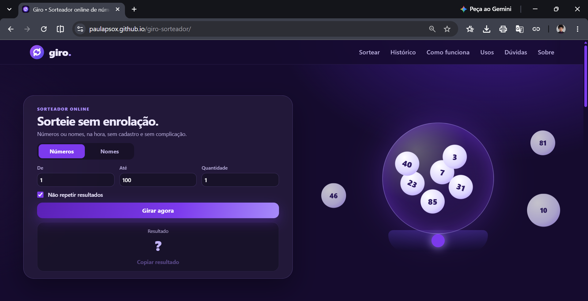
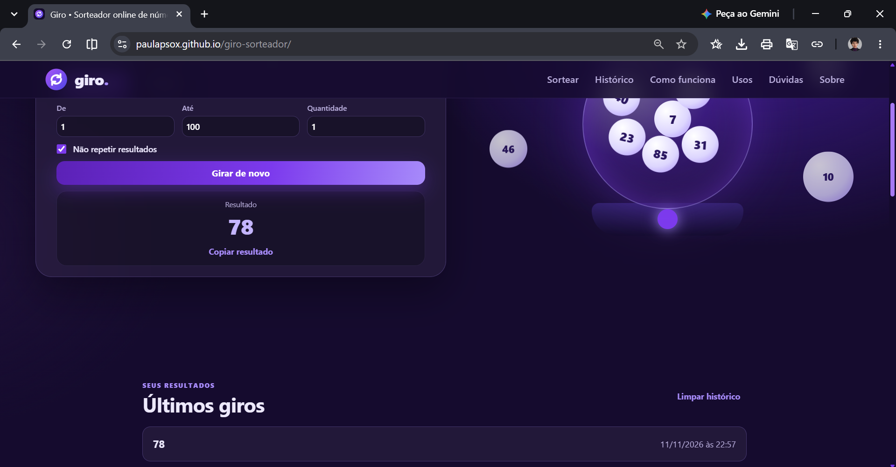
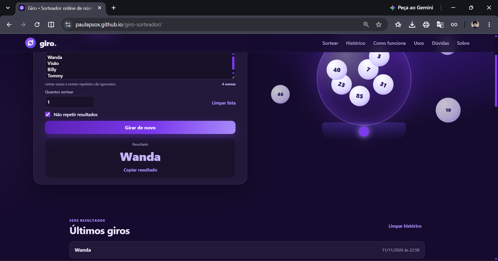

<div align="center">

# 🎲 GIRO SORTEADOR 🎯
### Números e nomes. Um sorteio, várias possibilidades.

Uma aplicação web para realizar sorteios de forma prática e intuitiva, com configurações personalizadas, resultados aleatórios e histórico local.

<br>

[](https://paulapsox.github.io/giro-sorteador/)

[](https://github.com/paulaPSOx/giro-sorteador)

<br>



<br>


</div>

---

## 📌 Sobre o projeto

O **Giro Sorteador** é uma aplicação web desenvolvida para facilitar a realização de sorteios de números e nomes, reunindo diferentes possibilidades de configuração em uma única interface.

A aplicação permite definir intervalos numéricos, inserir listas de participantes, controlar a repetição de resultados e consultar sorteios anteriores.

O desenvolvimento foi realizado utilizando HTML5, CSS3 e JavaScript puro (Vanilla JavaScript), sem a utilização de frameworks, com foco na organização do código, manipulação do DOM e experiência do usuário.

## 🖥️ Demonstração

### Sorteio de números



Defina o intervalo numérico, escolha a quantidade de resultados e configure se os números poderão ser repetidos.

### Sorteio de nomes



Adicione os participantes, acompanhe a quantidade de nomes válidos e realize sorteios personalizados a partir da lista informada.

---

## ⚙️ Funcionalidades

**Sorteio de números**
- Definição de valores mínimo e máximo.
- Escolha da quantidade de números sorteados.
- Opção para permitir ou impedir repetições.

**Sorteio de nomes**
- Inserção de participantes por lista.
- Identificação e remoção de linhas vazias.
- Identificação de nomes duplicados.
- Contador atualizado conforme a lista é preenchida.
- Ajuste automático da quantidade máxima de sorteios quando a repetição está desativada.
- Atalho `Ctrl + Enter` ou `Cmd + Enter` para iniciar o sorteio.

**Resultados e histórico**
- Exibição dos resultados na interface.
- Opção para copiar os resultados.
- Histórico dos últimos oito sorteios.
- Registro de data e horário.
- Armazenamento local com LocalStorage.
- Confirmação antes de apagar o histórico.

**Interface e experiência**
- Layout responsivo para diferentes dispositivos.
- Menu de navegação adaptado para telas menores.
- Animações e efeito visual de confetes.
- Navegação por teclado.
- Indicação visual de foco.
- Respeito à preferência do sistema por movimento reduzido.

---

## 🛠️ Tecnologias utilizadas

<div align="center">


</div>

| Tecnologia | Aplicação |
|---|---|
| HTML5 | Estrutura semântica e organização do conteúdo. |
| CSS3 | Estilização, layout responsivo, transições e animações. |
| JavaScript | Lógica dos sorteios, validações, eventos e manipulação do DOM. |
| Web Crypto API | Geração de valores aleatórios por meio de `crypto.getRandomValues()`. |
| LocalStorage | Armazenamento local do histórico de sorteios. |
| Canvas API | Renderização do efeito de confetes. |

---

## 💡 Implementação e decisões técnicas

Além da construção da interface, alguns recursos foram implementados para garantir o funcionamento e a consistência dos sorteios.

**Geração de valores aleatórios**

Utilização da Web Crypto API com `crypto.getRandomValues()` e amostragem por rejeição, evitando o viés de distribuição que pode ocorrer em implementações baseadas apenas no operador módulo.

**Seleção sem repetição**

Implementação do algoritmo Fisher-Yates parcial para selecionar índices únicos, sem a necessidade de embaralhar toda a lista.

**Validação e tratamento de entradas**

Verificação dos valores informados, dos limites numéricos e da quantidade de participantes disponíveis antes de executar cada sorteio.

**Persistência de dados**

Utilização do LocalStorage para manter o histórico dos últimos oito sorteios, com informações de data e horário, mesmo após atualizar ou fechar a página.

**Acessibilidade e interação**

Implementação de navegação por teclado nas abas, atributos ARIA, indicação de foco e respeito à configuração de movimento reduzido do dispositivo.

---

## 📂 Estrutura do projeto

```text
giro-sorteador/
│
├── assets/
│   └── images/
│       └── favicon.svg
│
├── css/
│   └── style.css
│
├── js/
│   └── script.js
│
├── image-proj/
│   ├── giro-sorteador.png
│   ├── giro-sorteador-numeros.png
│   └── giro-sorteador-nomes.png
│
├── .gitignore
├── index.html
└── README.md
```

---

## 🚀 Como executar o projeto

Não é necessário instalar dependências ou configurar frameworks para executar a aplicação.

**1. Clone o repositório:**

```bash
git clone https://github.com/paulaPSOx/giro-sorteador.git
```

**2. Acesse a pasta do projeto:**

```bash
cd giro-sorteador
```

**3. Abra o projeto no Visual Studio Code.**

**4. Execute o arquivo `index.html` utilizando o Live Server.**

Também é possível abrir o arquivo diretamente no navegador. Para melhor compatibilidade com recursos como a Clipboard API, recomenda-se utilizar um ambiente local (`localhost`) ou HTTPS.

---

## 🔒 Armazenamento e privacidade

O Giro utiliza o armazenamento local do navegador para manter o histórico dos sorteios.

- O histórico fica armazenado no próprio navegador.
- São mantidos os oito registros mais recentes.
- A lista de nomes digitada não é armazenada.
- O usuário pode apagar o histórico diretamente pela aplicação.
- A limpeza dos dados do site no navegador também remove o histórico salvo.

A aplicação não exige cadastro ou criação de conta para sua utilização.

---

## 📚 Aprendizados e desenvolvimento

O desenvolvimento deste projeto permitiu trabalhar e consolidar conhecimentos fundamentais de Front-end, principalmente em JavaScript.

Entre os principais conceitos aplicados estão:

- Manipulação do DOM e atualização dinâmica de elementos.
- Tratamento de eventos e interações do usuário.
- Funções, arrays e estruturas condicionais.
- Algoritmos de seleção aleatória.
- Validação e tratamento de dados.
- Armazenamento de informações com LocalStorage.
- Utilização de APIs nativas do navegador.
- Organização e separação de arquivos HTML, CSS e JavaScript.
- Responsividade e acessibilidade.

---

## ⚠️ Observação sobre os sorteios

O Giro utiliza a Web Crypto API para geração dos valores aleatórios, com uma estratégia de amostragem que evita viés na distribuição.

A aplicação é destinada a sorteios de uso cotidiano e informal. Não substitui sistemas especializados de auditoria ou plataformas certificadas para sorteios regulamentados ou premiações de alto valor.

---

<div align="center">

## 👩‍💻 Desenvolvido por Paula Oliveira

Desenvolvimento Front-end

[](https://github.com/paulaPSOx)
[](https://www.linkedin.com/in/oliveiraspaula/)

<br>

*Projeto desenvolvido para praticar e aprimorar conhecimentos em desenvolvimento Front-end.*

</div>
